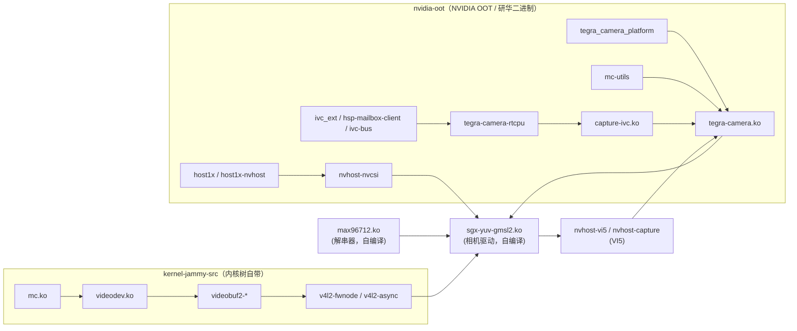
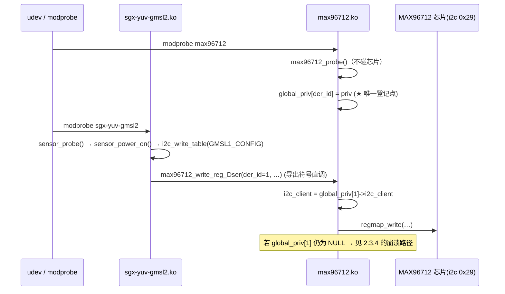
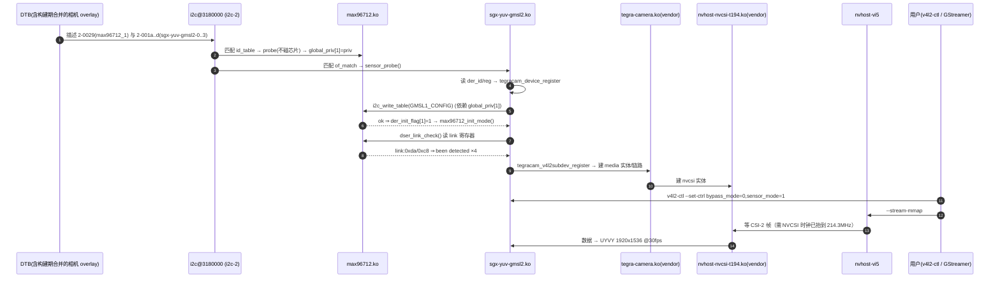

# 第 2 章　相机软件栈与「加载 / 初始化 / 出图」全流程

> **本章定位**：给从零接手 MIC-712AR 相机软件的工程师一份"能照着走通、也能照着排障"的说明。
> 重点是**软件栈各模块谁负责什么、谁必须先加载、开机时到底按什么顺序发生了什么事**，
> 以及本会话最关键的一个案例：**开机 panic（NULL 解引用，故障地址 `0x88`）的成因、证据与修复**。
>
> **配套材料**
> - 第 1 章 / 分析报告：`MIC-712AR相机不出图问题分析报告.md`（现象、fsync/PWM 触发链路、分辨率结论）
> - 附录：`MIC-712AR相机排查过程明细.md`（完整排查路径与被否定的假设）
> - 厂商原始资料：`MIC-712AR_Orin_NX_JP6.2_Sensing_Universal_V1.0.0_source/`（`init.sh`、`clock_config.sh`、`ko/`、`dtb/`）
>
> **证据标注约定（全文遵守）**
>
> | 标记 | 含义 |
> |---|---|
> | 【实测】 | 在硬件/构建机上真实执行并看到输出（附命令或输出片段） |
> | 【代码依据 `file:line`】 | 直接来自源码某行，可点击核对 |
> | 【推断】 | 由代码+实测推导，未直接观测 |
> | 【待验证】 | 尚未确认，不可当结论用 |
>
> 源码路径约定（下称 `$SRC`）：
> `source/nvidia-oot/drivers/media/i2c/MIC-MAX96712/`（构建机：
> `/data2/works/MIC-712AR_OrinNX_6.2.0_V1.0.1_SDK_build_cicd/MIC-712-build/source/...`；
> 构建实际使用的副本在 `work/mic712/Linux_for_Tegra/source/...`）。

---

## 2.0　本章结论速览

1. **相机出图靠 5 个"相机模块"+ 一长串 nvidia-oot/内核依赖**，其中 **`tegra-camera.ko`、`nvhost-nvcsi-t194.ko`、`capture-ivc.ko` 必须用研华预编译件**（无源码 / 自编译会 NULL 崩溃）；**`max96712.ko`、`sgx-yuv-gmsl2.ko` 已改为自编译**（源码在树里）。
2. 两个 i2c 驱动是**直接函数调用**关系：`sgx-yuv-gmsl2` 通过**导出符号** `max96712_write_reg_Dser/read_reg_Dser/write_reg_reg16_val16` 操作解串器。
3. 这些导出函数依赖模块内全局数组 **`global_priv[device_id]`**（`max96712.c:31`），而它**只在 `max96712_probe → max96712_debugfs_init` 里登记**（`max96712.c:219`）。
4. **`max96712_probe()` 全程不碰芯片**（只 kzalloc + `devm_regmap_init_i2c` + debugfs，`max96712.c:252-280`）⇒ **它不会因为"解串器还没上电/时序不对"而失败** ⇒ 剩下的唯一变量就是**谁先执行**。
5. 开机时 udev 会按 modalias 抢先 `modprobe sgx-yuv-gmsl2`，此刻 `max96712` 可能还没加载 ⇒ `global_priv[1] == NULL`。
6. 研华**新版** `max96712.c` 在这个分支上**没有 NULL 保护**：`if (global_priv[device_id] == NULL) dev_err(&i2c_client->dev, ...)`（`max96712.c:44-45`、`80-81`、`113-114`），而 `i2c_client` 被**显式初始化为 `NULL`**（`max96712.c:39/76/109`），且**没有 `return`**。
7. `dev_err(&((struct i2c_client*)NULL)->dev, ...)` ⇒ `dev_err(0x20, ...)` ⇒ `dev_driver_string()` 去读 `dev->driver`（偏移 `0x68`）⇒ **故障地址 `0x20 + 0x68 = 0x88`**，与本会话实测 oops 的 `0000000000000088` + `dev_driver_string` **完全吻合**。
8. **反汇编证明这是"新版回归"**：研华**旧版** ko（`f0894188`）`cbz x0, 0xdc` → `mov w19,#-1` = **纯返回**（安全），但它 `alias` 只有 `i2c:max96712`，**绑定不上** `max96712_1`（相机永不出图）；研华**新版** ko（`0160ceb1`/`8114ce0e`）与我们旧版构建（`baec074c`）**机器码一致**：`cbz x0, 0x108` → `mov x0,#0x20` → `bl _dev_err` **＝自爆**。
9. **修复 = 两条腿**（提交 `36c47474b`）：① 驱动侧恢复 NULL/越界保护（`pr_err` + `return -ENODEV`，不再使用无效 device 指针）＝**安全网**；② `softdep sgx-yuv-gmsl2 pre: max96712`＝**顺序保证（这才是让相机出图的功能修复）**。
10. **⚠️ 实测修正（内核 #14，2026-10-16）**：`softdep` 只保证 **modprobe 调用顺序**，**不保证 probe 完成顺序**。
    udev 是并发加载的，实测 `max96712_probe`（11.524 s）比 sgx 四路 probe（10.90–11.50 s）**晚 0.6 s** ⇒ 四路 DER 初
    始化被跳过（`can't find DER adapt broad`）⇒ `link_num=0` + 取流 `uncorr_err` 超时 ⇒ **不崩但不出图**。
    正确做法：`install sgx-yuv-gmsl2 /bin/true` 挡住 udev 早期加载 + 开机服务**等 `/sys/bus/i2c/drivers/max96712/2-0029`
    出现后再 `modprobe --ignore-install sgx-yuv-gmsl2`**（提交 `5eb5d87e8`：`mic712-camera.service` + `mic712-camera-up.sh`，
    带 unbind/bind 自愈）。详见 05 章案例 4。
    【待验证】仍需在刷机后的真机上核对 dmesg 里 `max96712_probe: probe success` **出现在** sgx 的 `tegracam sensor driver` 之前。
11. 开机后**还有两个与驱动无关的前置条件**：DT overlay 必须在**构建期**合进 DTB（UEFI OVERLAYS 路由在本板不生效）、**NVCSI 时钟必须抬到 214.3 MHz**（否则 `corr_err: discarding frame` / `request timed out`）。
12. 取流必须 **`sensor_mode` 与 DT 分辨率一致 + `bypass_mode=0`**；本板实测可用组合是 `sensor_mode=1` + `1920x1536 UYVY`（30.00 fps）。

---

## 2.1　模块清单与职责

### 2.1.1　全景表

| 模块（模块名 = 文件名） | 源码 / 来源 | 职责 | 谁提供 | 依据 |
|---|---|---|---|---|
| **`max96712`** | `$SRC/max96712.c`（7436 B，md5 `343455af`①） | **解串器驱动（"寄存器搬运工"）**：导出 `max96712_write_reg_Dser` / `max96712_read_reg_Dser` / `max96712_write_reg_reg16_val16`；维护 `global_priv[4]`；建 `/sys/kernel/debug/max96712_N`。**不直接注册 V4L2 设备** | ✅ 自编译 | 【代码依据 `max96712.c:31,36-134,219,252-280`】【实测 modinfo 4 个别名】 |
| **`sgx-yuv-gmsl2`** | `$SRC/sgx-yuv-gmsl2.c`（29130 B，md5 `f2c52a51`）+ `sgx-yuv-gmsl2-tbls.h`（478 行） | **相机（sensor 包装）驱动**：tegracam 驱动，绑定 4 个 i2c 客户端 `2-001a..2-001d`（compatible `sensing,sgx-yuv-gmsl2-0..15`）；负责上电、GMSL 链路检查、模式表下发、V4L2 subdev 注册 | ✅ 自编译 | 【代码依据 `sgx-yuv-gmsl2.c:46-65,834-941,955-988`】 |
| **`tegra-camera`** | 研华预编译 1497344 B（sha256 前 16 位 `c7a5f044d7373ff0`） | NVIDIA Tegra 相机核心（`camera_common_*`、`tegracam_core`、VI/NVCSI 胶水） | ⚠️ **必须用研华件** | 【实测 `vendor/camera-modules/README.md`】 |
| **`nvhost-nvcsi-t194`** | 研华预编译 47256 B（`a2b15d0230a60e9c`） | NVCSI（CSI-2 接收/VC 解复用） | ⚠️ **必须用研华件** | 同上 |
| **`capture-ivc`** | 研华预编译 110264 B（`1a00e218c6b8dbd5`） | VI 与 RTCPU（camera-rtcpu）之间的 IVC 通道 | ⚠️ 沿用研华件② | 同上 |
| `tegra_camera_platform` | nvidia-oot 自编译 | 相机平台设备（`/dev/tegra_camera_ctrl`、带宽/时钟汇总） | 自编译 | 【实测 `modules.dep`】 |
| `mc-utils` | nvidia-oot 自编译 | media controller 里的多路 I2C 复用（virtual_i2c_mux 等） | 自编译 | 【实测 `modules.dep`】 |
| `ivc-bus` / `tegra-camera-rtcpu` / `hsp-mailbox-client` / `ivc_ext` | nvidia-oot 自编译 | RTCPU（camera firmware）侧的 IVC/邮箱基础设施 | 自编译 | 【实测 `modules.dep`】 |
| `host1x` / `host1x-nvhost` / `nvhost-nvcsi` / `nvhost-vi5` / `nvhost-capture` | nvidia-oot 自编译 | host1x 家族与 VI5 主机驱动 | 自编译 | 【实测 `modules.dep`】 |
| `v4l2-dv-timings` / `v4l2-fwnode` / `v4l2-async` / `videodev` / `mc` / `videobuf2-*` | **kernel-jammy-src** 自带 | 通用 V4L2 / media / videobuf2 框架 | 内核树 | 【实测 `modules.dep` 路径前缀 `kernel/`】 |

① 现在 `$SRC/max96712.c` 已是**打过补丁**的版本（8816 B，md5 `61b53a82`，见 2.3.7）；`343455af` 是补丁前的原始版本，与研华 SENSING 包内源码**逐字节相同**。
② `capture-ivc.c` 研华**有**提供源码，且与我们树里的**逐字节相同**；之所以仍沿用研华 `.ko`，是为了与另外两个"必须用二进制"的模块**整组一致**（详见 `vendor/camera-modules/README.md`）。

### 2.1.2　模块依赖链（`modules.dep` 原始记录）

【实测·构建机 `work/.../rootfs/lib/modules/5.15.148-tegra/modules.dep`】

```text
updates/drivers/media/i2c/MIC-MAX96712/sgx-yuv-gmsl2.ko:
    updates/drivers/media/i2c/MIC-MAX96712/max96712.ko          ← ★ 先解串器
    updates/drivers/media/platform/tegra/camera/tegra-camera.ko
    kernel/drivers/media/v4l2-core/v4l2-dv-timings.ko
    updates/drivers/video/tegra/host/nvcsi/nvhost-nvcsi.ko
    updates/drivers/gpu/host1x-nvhost/host1x-nvhost.ko
    updates/drivers/gpu/host1x/host1x.ko
    updates/drivers/video/tegra/camera/tegra_camera_platform.ko
    updates/drivers/platform/tegra/mc-utils/mc-utils.ko
    updates/drivers/platform/tegra/rtcpu/capture-ivc.ko
    updates/drivers/platform/tegra/rtcpu/tegra-camera-rtcpu.ko
    updates/drivers/platform/tegra/rtcpu/ivc-bus.ko
    updates/drivers/platform/tegra/rtcpu/hsp-mailbox-client.ko
    updates/drivers/firmware/tegra/ivc_ext.ko
    kernel/drivers/media/v4l2-core/v4l2-fwnode.ko
    kernel/drivers/media/v4l2-core/v4l2-async.ko
    kernel/drivers/media/common/videobuf2/videobuf2-dma-contig.ko
    kernel/drivers/media/common/videobuf2/videobuf2-memops.ko
    kernel/drivers/media/common/videobuf2/videobuf2-v4l2.ko
    kernel/drivers/media/common/videobuf2/videobuf2-common.ko
    kernel/drivers/media/v4l2-core/videodev.ko
    kernel/drivers/media/mc/mc.ko
```

> 命名细节【待验证】：`modules.dep` 里出现的是 `nvhost-nvcsi.ko`，而研华预编译件安装在
> `updates/drivers/video/tegra/host/nvcsi/nvhost-nvcsi-t194.ko`（同为该目录）。两者是否同一模块的不同命名，
> 需要在板上 `modinfo -n nvhost-nvcsi` / `modinfo -n nvhost-nvcsi-t194` 核对。

依赖关系图（把上表压缩成两条链）：



读法：**`sgx-yuv-gmsl2` 站在最上层**，它下面是"解串器驱动 + Tegra 相机核心 + CSI/VI + RTCPU 固件通道"，
最底是内核自带的 V4L2/media 框架。**任何一层缺失或顺序错误，`/dev/video*` 都不会出图。**

### 2.1.3　哪些必须用研华预编译件？哪些已改为自编译？

**（A）必须用研华预编译件（3 个）** —— 依据 `vendor/camera-modules/README.md` 原文：

> 相机出图需要**打过补丁的** `tegra-camera.ko` 和 `nvhost-nvcsi-t194.ko`。研华的 SENSING 包里**没有提供这两个文件的源码**：
> `.../source/` 26 个文件（10 个 `.c`、2 个 dts），**只有 `capture-ivc.c`**……没有 `tegra-camera.c`，没有 `nvhost-nvcsi-t194.c`。
> 用我们自己编译的版本去 probe 相机设备树，**内核会直接崩**：
> ```
> [ 11.020266] Unable to handle kernel NULL pointer dereference at virtual address 0000000000000088
> ```
> 换成研华这几个预编译模块就正常（硬件已验证：4 个 `/dev/video*`、`tegra-camera-platform`、
> `max96712_1@29`、`sgx-yuv-gmsl2 2-001a..001c` 全部起来）。

⇒ `tegra-camera.ko`、`nvhost-nvcsi-t194.ko`、`capture-ivc.ko` **保持研华二进制**；
构建时由 `shell/build.sh` 的 `install_camera_modules()` 在装完自编译模块之后**覆盖**上去，再统一 `depmod`
（日志打印 `<N> vendor camera module(s) installed over the built ones`，【代码依据 `shell/build.sh:563-575`】）。

**（B）已改为自编译（2 个）** —— 二者源码都在树里，且**必须**这样做：

| 模块 | 研华预编译件的问题 | 自编译版 | 依据 |
|---|---|---|---|
| `max96712.ko` | 只声明 `alias: i2c:max96712` → 匹配不上 DT 节点 `max96712_1@29`（客户端名 `max96712_1`）→ **永不 probe** → 相机全不出图 | 声明 `i2c:max96712_0/_1/_2/_3` 四个别名 → 能绑定 `max96712_1`（`der_id=1`） | 【实测 modinfo：研华件 1 个别名 / 自编译 4 个】【`vendor/camera-modules/README.md`】 |
| `sgx-yuv-gmsl2.ko` | 与自编译版**同源同版本**（描述/vermagic/参数 `GMSLMODE_0..3`/内部字符串一致），无功能差异 | 板上实测 3 轮 × 4 路（30/30/100 帧）全部出帧、30.00 fps、VI 错误 0 | 【实测·上一轮】 |

两个不再使用的研华二进制**已改名留档**，避免再次被误装：
```
vendor/camera-modules/max96712.ko.bad-i2c-aliases     ← 原 max96712.ko（别名不全）
vendor/camera-modules/sgx-yuv-gmsl2.ko.vendor-reference
```
【代码依据 `shell/build.sh` 的 `camera_module_relpaths()`】（现在只剩 3 个路径）

### 2.1.4　模块安装路径（rootfs 内）

【实测·构建机 `find rootfs/usr/lib/modules/5.15.148-tegra/updates`】

| 模块 | 安装路径（`/usr/lib/modules/5.15.148-tegra/` 之下） |
|---|---|
| `max96712.ko` | `updates/drivers/media/i2c/MIC-MAX96712/max96712.ko` |
| `sgx-yuv-gmsl2.ko` | `updates/drivers/media/i2c/MIC-MAX96712/sgx-yuv-gmsl2.ko` |
| `tegra-camera.ko` | `updates/drivers/media/platform/tegra/camera/tegra-camera.ko` |
| `nvhost-nvcsi-t194.ko` | `updates/drivers/video/tegra/host/nvcsi/nvhost-nvcsi-t194.ko` |
| `capture-ivc.ko` | `updates/drivers/platform/tegra/rtcpu/capture-ivc.ko` |
| `tegra_camera_platform.ko` | `updates/drivers/video/tegra/camera/tegra_camera_platform.ko` |
| `mc-utils.ko` | `updates/drivers/platform/tegra/mc-utils/mc-utils.ko` |

> 大小写细节：目录名是 **`MIC-MAX96712`**（不是 `mic-max96712`），`/lib/modules/<rel>` 与
> `/usr/lib/modules/<rel>` 在本镜像里都存在（Ubuntu 的模块实际在 `usr/lib`，`lib` 是符号链接或并存目录）
> ——【实测】两者都能找到 `modules.dep`，`depmod -b <rootfs> <release>` 会同时处理。

---

## 2.2　加载机制：谁来加载、按什么顺序、靠什么匹配

### 2.2.1　两个配置文件

| 文件 | 作用 | 内容（本 SDK 覆盖层） |
|---|---|---|
| `/etc/modules-load.d/mic712-camera.conf` | **开机点名加载**（`systemd-modules-load.service` 按顺序 `modprobe` 每个模块名） | 按顺序列出相机模块（含 `max96712`、`sgx-yuv-gmsl2` 等）【代码依据 `custom/rootfs/etc/modules-load.d/mic712-camera.conf`】 |
| `/etc/modprobe.d/mic712-camera.conf` | **modprobe 的行为规则**：参数（`options`）、顺序依赖（`softdep`）、拦截（`install`/`blacklist`） | 至少含 `options sgx-yuv-gmsl2 GMSLMODE_1=2,2,2,2`；本轮新增 `softdep sgx-yuv-gmsl2 pre: max96712`【代码依据 `custom/rootfs/etc/modprobe.d/mic712-camera.conf`，提交 `36c47474b`】 |

### 2.2.2　`options` / `softdep` / `install` 三种指令的语义

（kmod/modprobe 通用机制，非本板特有）

| 指令 | 语义 | 本项目的用途 |
|---|---|---|
| `options <mod> k=v ...` | 每次 `modprobe <mod>` 时附加模块参数 | `GMSLMODE_1=2,2,2,2`：告诉 sgx"DER 板 #1 的四路都是 GMSL2/3G 器件"。**只能在加载时给**（参数是 `S_IRUGO` 只读，见 `sgx-yuv-gmsl2.c:237-240`） |
| `softdep <mod> pre: <dep>` | 加载 `<mod>` **之前**先加载 `<dep>`（对**任何**触发方式都生效，包括 udev 按 modalias 触发的） | `softdep sgx-yuv-gmsl2 pre: max96712`：**把"顺序"从"靠运气"变成"有保证"**（2.3 的核心） |
| `install <mod> <cmd...>` | 把对 `<mod>` 的所有加载动作**替换**成执行 `<cmd...>`（`/bin/true` = 彻底禁止加载） | 抢救用：`install max96712 /bin/true` / `install sgx-yuv-gmsl2 /bin/true` 可让 panic 中的板子先能开机；也可配合"延迟加载服务"用 `install sgx-yuv-gmsl2 /bin/true` 挡住早期加载，再由服务 `modprobe --ignore-install` 拉起 |

### 2.2.3　udev 按 modalias 触发加载（本板 panic 的现场）

内核为每个设备生成 **modalias**，udev 收到 `uevent` 后执行 `modprobe <modalias>`。相机相关两类：

| 设备 | modalias 形态 | 由哪个模块的别名命中 |
|---|---|---|
| i2c 客户端 `2-0029`（解串器） | `i2c:max96712_1` | `max96712` 的 `MODULE_DEVICE_TABLE(i2c, ...)` → `i2c:max96712_{0..3}`【代码依据 `max96712.c:295-304`】 |
| i2c 客户端 `2-001a..d`（相机） | `of:N*T*Csensing,sgx-yuv-gmsl2-N` | `sgx-yuv-gmsl2` 的 `MODULE_DEVICE_TABLE(of, ...)`（16 条）【实测 `modules.alias` 原样片段】 |

【实测·构建机 `modules.alias`】
```text
alias of:N*T*Csensing,sgx-yuv-gmsl2-15C* sgx_yuv_gmsl2
alias of:N*T*Csensing,sgx-yuv-gmsl2-15  sgx_yuv_gmsl2
...（0..15 共 32 行）
```

**关键点：udev 事件与 `systemd-modules-load` 是并发的**。因此"文件里写的是 max96712 在前"**不等于**"运行时 max96712 一定先 probe"——这正是本章案例的入口。

### 2.2.4　加载时序：正常路径 vs 出问题的竞态

```text
【正常路径】                                    【出问题的竞态（本会话实测到的那次）】
上电                                            上电
  │                                               │
内核 probe i2c 控制器 3180000.i2c               内核 probe i2c 控制器 3180000.i2c
  ├─ 创建 2-0029（DT 顺序在前）★                  ├─ 创建 2-0029  → 内核广播 uevent
  └─ 创建 2-001a..2-001d                          └─ 创建 2-001a  → 内核广播 uevent
  │                                               │
systemd-modules-load: modprobe max96712        udev 先处理了 2-001a 的 uevent ★★
  └─ 驱动注册 → 立即 probe 2-0029                 └─ modprobe sgx-yuv-gmsl2
       └─ global_priv[1] = priv  ★                    └─ sgx probe → 调 max96712_*_reg_Dser(1,…)
systemd-modules-load: modprobe sgx-yuv-gmsl2              └─ global_priv[1] == NULL
  └─ 驱动注册 → probe 2-001a                                 └─ dev_err(&NULL->dev, …)  ⇒ panic 0x88
       └─ 调用 max96712_*_reg_Dser(1,…) ok
```
★ `2-0029` 是否早于 `2-001a` 创建，取决于 **DT 里节点的先后**；本板 `live.dts` 中
`max96712_1@29`（line 5513）在 `cam_0@1a`（line 5519）之前【代码依据 `live.dts:5513,5519`】——
**内核侧是"先解串器、后相机"的**；被打乱的是**驱动加载/探测**这一层，不是设备创建这一层。

---

## 2.3　本章核心：为什么 `max96712` 必须先 probe

### 2.3.1　调用链与 `global_priv[]`



### 2.3.2　代码依据（`file:line` + 片段）

**（a）全局指针数组**：
```c
struct max96712 *global_priv[4];                 // $SRC/max96712.c:31
```

**（b）三个导出函数都用它，且**没有**"为空就返回"的保护（原始版本）：
```c
int max96712_write_reg_Dser(int device_id, int slaveAddr, u16 addr, u8 val)
{
	struct i2c_client *i2c_client = NULL;        // :39  ← 显式 NULL
	if (global_priv[device_id] == NULL)
		dev_err(&i2c_client->dev, "can't find Der device!\n");   // :44-45 ← 用 NULL 推导出的指针
	i2c_client = global_priv[device_id]->i2c_client;             // :47    ← 赋值在检查之后
	bak = i2c_client->addr;                                      // :48    ← 就算上面不崩，这里也崩
	...
}
EXPORT_SYMBOL(max96712_write_reg_Dser);          // :71
```
同样模式出现 **3 处**：`:44-45`（write）、`:80-81`（write table）、`:113-114`（read）。

**（c）`global_priv[]` 的唯一登记点**（注意位置在任何可能失败操作**之前**）：
```c
static int max96712_debugfs_init(...)             // :205
{
	...
	err = snprintf(dev_name, sizeof(dev_name), "max96712_%d", priv->device_id);  // :215
	if (err < 0) return -EINVAL;                                                // :216-217
	global_priv[priv->device_id] = priv;         // :219  ★★ 登记
	dev_dbg(&i2c_client->dev, ...);              // :221
	dp = debugfs_create_dir(dev_name, NULL);     // :223  ← 到这里才可能失败
	if (dp == NULL) { dev_err(...); return -ENOMEM; }                            // :224-228
	...
}
```

**（d）调用方（sgx 侧）**：`sgx_yuv_gmsl2` 通过 `extern` 声明直接调用（不是 ops 回调，也不是 ioctl）：
```c
extern int max96712_write_reg_Dser(int device_id, int slaveAddr, u16 addr, u8 val);      // sgx-yuv-gmsl2.c:38
extern int max96712_read_reg_Dser (int device_id, int slaveAddr, u16 addr, unsigned int *val); // :41
```
调用点密集在 `i2c_write_table()`（`:387`）、`dser_link_check()`（`:299,301,307`）、
`max96712_init_mode()`（`:741-796`）、`sensor_start/stop_streaming()`（`:696,699,701,721`）。

### 2.3.3　为什么 `max96712_probe()` **不可能**失败

```c
static int max96712_probe(struct i2c_client *client, const struct i2c_device_id *id)   // $SRC/max96712.c:252
{
	priv = devm_kzalloc(&client->dev, sizeof(*priv), GFP_KERNEL);   // :260  纯内存
	priv->i2c_client = client;                                      // :261
	priv->regmap = devm_regmap_init_i2c(priv->i2c_client, &max96712_regmap_config); // :262  只建 regmap，无 I2C 流量
	if (IS_ERR(priv->regmap)) { dev_err(...); return -ENODEV; }      // :264-268
	priv->device_id = id->driver_data;                              // :270
	err = max96712_debugfs_init(NULL, NULL, NULL, priv);            // :272  ← global_priv 在这里登记
	if (err) return err;                                            // :273-274
	dev_info(&client->dev, "%s: probe success\n", __func__);        // :277  ← 日志锚点！
	return err;
}
```
【代码依据 `max96712.c:252-280`】

| 结论 | 说明 |
|---|---|
| **probe 不读芯片** | 全程没有 `regmap_read/write`；`devm_regmap_init_i2c` 只是把 client/regmap 关联起来 |
| ⇒ **不会因为"相机/解串器未上电"而失败** | 因此不存在"加载了但因为时序没绑上"的静默失败路径 |
| ⇒ **唯一变量是"谁先执行"** | 只要 `modprobe max96712` 先跑（且 `2-0029` 已存在），`global_priv[1]` 必然就绪 |
| 【实测】可验证的日志锚点 | 成功会打印 `max96712 2-0029: max96712_probe: probe success` |

> 【推论/待验证】`max96712_debugfs_init()` 若在 `debugfs_create_dir` 上失败会返回 `-ENOMEM`，
> 此时 `global_priv[]` 已被赋值（`:219` 在失败点之前）→ probe 回滚后 `global_priv[]` 会**指向已释放对象**。
> 本镜像 debugfs 已挂载（NVCSI 时钟就通过 `/sys/kernel/debug/bpmp/...` 设置），该路径不会触发；
> 但这属于厂商代码的**次要隐患**，建议反馈。

### 2.3.4　竞态 → NULL 解引用 → 故障地址 `0x88` 的推导

触发条件【推断，紧贴实测】：**udev 先按 modalias 加载 `sgx-yuv-gmsl2`**（2.2.4 竞态），
此时 `max96712` 尚未加载/尚未 probe ⇒ `global_priv[1] == NULL` ⇒ 走到 `max96712.c:44-45`：

```c
struct i2c_client *i2c_client = NULL;             // 指针值 = 0
dev_err(&i2c_client->dev, "can't find Der device!\n");
```

地址推导：

| 步骤 | 表达式 | 值 |
|---|---|---|
| ① | `&i2c_client->dev` | `0 + offsetof(struct i2c_client, dev)` = **`0x20`** |
| ② | `dev_err(dev, fmt, ...)` 内部会调 `dev_driver_string(dev)` | 参数 `dev = 0x20` |
| ③ | `dev_driver_string()` 读 `dev->driver` | `0x20 + offsetof(struct device, driver)` = `0x20 + 0x68` = **`0x88`** |
| ④ | 该地址不可读（用户态页表无映射，`pgd=0`） | **`Unable to handle kernel NULL pointer dereference at virtual address 0000000000000088`** |

**本会话实测 oops 的关键字段**（与本推导一致）【实测】：

| oops 字段 | 实测值 |
|---|---|
| 故障地址 | `0000000000000088` |
| 故障符号 | `dev_driver_string`（`pc` / `lr` 同址） |
| 触发进程 | `systemd-udevd`（PID 351） |
| 时间点 | 开机约 **11.8 s**（模块加载阶段） |
| 内核 | `5.15.148-tegra #13` |
| 模块列表 | 含 `max96712(OE)`、`sgx_yuv_gmsl2(OE)`、`tegra_camera_platform(OE)`、`capture_ivc(OE)` 等 |
| 其它 | `ESR = 0x0000000096000004`、`EC = 0x25: DABT`、`FSC = 0x04: level 0 translation fault`、`Data abort`、`user pgtable ... pgd=0000000000000000` |

> 【待验证】`/sys/fs/pstore/` 里的 ramoops 完整 oops（含 Call trace）尚未取回；板子恢复后应立刻抓取，
> 用 `Call trace` 里的**调用者模块名**把"崩在 `max96712` 还是 `sgx`"彻底钉死（见 2.3.9 的说明）。

### 2.3.5　反汇编证据表（本会话实测，独立复核过两次）

命令模板（构建机，交叉 objdump）：
```bash
OBJ=/opt/aarch64--glibc--stable-2022.08-1/bin/aarch64-buildroot-linux-gnu-objdump
$OBJ -d <max96712.ko> | awk '/<max96712_write_reg_Dser>:/{f=1} f{print} f&&/^$/{exit}'
```

| 候选 | md5（前 8） | 别名数 | `write_reg_Dser` 里的保护 | `cbz` 的**目标**是什么 | dev_err 调用数 | 结果 |
|---|---|---|---|---|---|---|
| 研华**旧版** `ko/MIC_SGX_YUV_GMSL2/max96712.ko` | `f0894188` | **1**（`i2c:max96712`） | ✅ `cmp w20,#0x3` + `b.hi` 越界检查、`cbz x0,0xdc` | `0xdc: mov w19,#0xffffffff` → `b c0`（**纯返回 -1**） | 1 | **不崩，但永不绑定** |
| 研华**新版** `ko/SGX_YUV_GMSL2/max96712.ko` | `0160ceb1` | 4 | ❌ 无越界检查；`cbz x0,0x108` | `0x108: mov x0,#0x20` → `bl _dev_err` → `ldr x0,[…]` → `b a8`（**打印后再解引用**） | **3** | ⚠️ **会崩** |
| 研华**新版** `ko_backup/MIC_SGX_YUV_GMSL2/max96712.ko` | `8114ce0e` | 4 | 同上（与上行**机器码一致**） | 同上 | **3** | ⚠️ 会崩 |
| 我们源码编的**旧版**（现 `max96712.ko.bak-panic`） | `baec074c` | 4 | 同上（**与研华新版同源同码**） | 同上 | **3** | ⚠️ **本次 panic 的那份** |
| **我们的修复版** | `8c70833d` | 4 | ✅ `cmp w20,#0x3` + `b.hi`、`cbz x0,0x10c` | `0x10c`：`_printk`（= `pr_err`，**不用 device 指针**）后 `return -ENODEV` | 2（仅剩指针校验之后的正常错误路径） | ✅ **能绑定 + 不崩** |

关键指令原文（两段对照，最直观）：

```asm
; —— 研华旧版 f0894188：NULL → 直接返回 ——
64: cmp  w20, #0x3
68: b.hi dc                         ; 越界 → 0xdc
74: ldr  x0, [x21, x20, lsl #3]     ; x0 = global_priv[device_id]
78: cbz  x0, dc                     ; NULL → 0xdc
...
d8: ret
dc: mov  w19, #0xffffffff            ; w19 = -1
e0: b    c0                         ; 回到返回序列（不打印、不碰 device）
```
```asm
; —— 研华新版 0160ceb1 / 8114ce0e / 我们旧版 baec074c：NULL → 打印 dev_err(0x20) ——
a0: ldr  x0, [x20, x19, lsl #3]     ; x0 = global_priv[device_id]
a4: cbz  x0, 108                    ; NULL → 0x108
a8: ldr  x24, [x0]                  ; 非空路径
...
104: ret
108: mov  x0, #0x20                  ; ★ device 指针 = 0x20 = &((i2c_client*)NULL)->dev
10c: adrp x1, ... ; add x1, x1, #0   ; "can't find Der device!"
114: bl   _dev_err                  ; ★★ dev_err(0x20, …) → dev_driver_string(0x20) → 读 0x88 → 崩
118: ldr  x0, [x20, x19, lsl #3]    ; （若上面侥幸没崩）继续取指针
11c: b    a8                        ; 又跳回去解引用
```

**这张表的三个结论**
1. **同一寄存器分支，旧版是"返回 -1"，新版是"拿 `0x20` 当 device 打印"** ⇒ 研华在**新版源码/新版 ko 里把保护弄丢了**（我们树里的 `max96712.c` 与研华新版同源，所以按源码编译必然继承这个缺陷）。
2. **换用研华新版预编译件也不是出路**——它和我们旧版构建**机器码一致**，一样会 panic。
3. 唯一"别名正确 + NULL 安全"的组合，是**我们打了保护补丁的自编译版**（提交 `36c47474b`）。

### 2.3.6　修复内容（提交 `36c47474b`）

**① 驱动侧：恢复保护（安全网）**——把三个函数里的

```c
if(global_priv[device_id] == NULL)
	dev_err(&i2c_client->dev, "can't find Der device!\n");
```
改成
```c
/* MIC-712AR fix: i2c_client 此处为 NULL，原 dev_err() 会经 dev_driver_string()
 * 解引用它并导致内核 NULL 崩溃（偏移 0x88）…… */
if (device_id < 0 || device_id >= ARRAY_SIZE(global_priv) ||
    global_priv[device_id] == NULL) {
	pr_err("max96712: no DER device for id %d (driver not probed yet)\n", device_id);
	return -ENODEV;
}
```
【代码依据：修复后的 `max96712.c` 三处；`$SRC` 现行文件 md5 `61b53a82`、8816 B】

**② 顺序侧：`softdep`（功能修复）**——`custom/rootfs/etc/modprobe.d/mic712-camera.conf` 追加：
```text
softdep sgx-yuv-gmsl2 pre: max96712
```

**③ 二者分工（务必分清）**

| 改动 | 属于 | 作用 | 若只有它 |
|---|---|---|---|
| `softdep` | **功能修复** | 保证任何 `modprobe sgx-yuv-gmsl2`（含 udev 触发）都先 `modprobe max96712`，而后者同步完成 probe ⇒ `global_priv[1]` 已就绪 | 顺序对就出图；**顺序万一又乱就崩** |
| NULL 保护 | **安全网** | 无论如何不再崩溃；最坏情况变成"打印 `no DER device` + 该相机不初始化" | 不崩，但相机可能静默不出图 |

### 2.3.7　判据 checklist（刷机/重启后逐条核对）

```bash
# ① 顺序对不对（最关键，一条判据定生死）
sudo dmesg | grep -E 'max96712_probe: probe success|tegracam sensor driver' | head -8
#   期望：max96712 2-0029: max96712_probe: probe success  出现在
#         sgx-yuv-gmsl2 2-001a: tegracam sensor driver:… 之前

# ② 驱动是否真的绑定到解串器
ls /sys/bus/i2c/drivers/max96712/            # 必须出现 2-0029
cat /sys/bus/i2c/devices/2-0029/name         # 应为 max96712_1

# ③ 四路是否被识别 / 有没有走"DER 未就绪"分支
sudo dmesg | grep -c 'been detected'                 # 期望 4
sudo dmesg | grep -c "can't find DER adapt broad"    # 期望 0
sudo dmesg | grep -c 'no DER device'                 # 期望 0（安全网没被触发）

# ④ 模块参数是否生效
cat /sys/module/sgx_yuv_gmsl2/parameters/GMSLMODE_1  # 期望 2,2,2,2

# ⑤ 出图（见 2.5.3 的完整命令；期望四路各 30/30 帧、30.00 fps、无 error）
```

### 2.3.8　一处易混：本板出现过**两次** `0x88`

| 案例 | 触发者 | 代码位置 | 现状 |
|---|---|---|---|
| **本会话 panic** | `max96712.c` 的 NULL `dev_err`（`&NULL->dev` = 0x20 ⇒ 0x20+0x68 = 0x88） | `max96712.c:44-45/80-81/113-114` | 已修（`36c47474b`） |
| 历史案例【实测·`vendor/camera-modules/README.md`】 | **自编译的 `tegra-camera.ko`/`nvhost-nvcsi-t194.ko`** 去 probe 相机 DT 时崩溃，日志同样是 `virtual address 0000000000000088` | 不在我们树里（无源码） | 规避方式＝**保留研华二进制**（2.1.3-A） |

⇒ **两者都表现为"把 NULL 当 `struct device *` 传进 `dev_*()`"**，仅故障地址巧合相同。
区分方法：看 oops 的 `pc`/`Call trace` **落在哪个模块**，以及伴随的 dmesg 上下文
（本会话案例伴随 `systemd-udevd` 在 ~11.8 s 加载模块；tegra-camera 案例伴随"相机设备树 probe"阶段）。

---

## 2.4　初始化时序（逐步）

### 2.4.1　`max96712` 侧（简单）

```c
static int __init max96712_init(void) { return i2c_add_driver(&max96712_i2c_driver); }   // :316-319
module_init(max96712_init);                                                              // :326
```
1. 模块加载 → `i2c_add_driver()` 注册驱动（`driver.name = "max96712"`，`id_table = max96712_id[]`，`:295-313`）。
2. 内核用 i2c 客户端名（本板 `max96712_1`）与 `id_table` 匹配 → 绑定 `2-0029`。
3. `max96712_probe()`：kzalloc → `devm_regmap_init_i2c` → `max96712_debugfs_init()`（`:219` 登记 `global_priv[1]`）→ 打印 `probe success`。
4. 之后任何模块都可以通过导出符号安全地操作解串器。

### 2.4.2　`sgx_yuv_gmsl2` 侧（`sensor_probe`，`sgx-yuv-gmsl2.c:834-941`）

| 步骤 | 行号 | 做了什么 | 失败/异常时的现象 |
|---|---|---|---|
| 1 | `:846-847` | 校验 `CONFIG_OF` 与 `dev->of_node` | 报 `-EINVAL` |
| 2 | `:849-857` | 分配 `struct sensor` / `struct tegracam_device` | 报 `unable to allocate memory!` |
| 3 | **`:859-861`** | 读 DT 属性 **`der_id`**（本板 = 1） | 报 `der_id not found`（**未 return，值保持 0** ⇒【推论】可能选错 GMSLMODE 组） |
| 4 | `:863-872` | 绑定 `i2c_client`、建 `regmap` | 报 `regmap init failed` |
| 5 | `:873-875` | 读 DT 属性 **`reg`** → `ser_addr`（串行器地址，本板 `0x34`） | 报 `ser_addr not found` |
| 6 | `:878-884` | 填 tegracam 结构（`sensor_ops`/`internal_ops`/`tcctrl_ops`） | — |
| 7 | **`:886-890`** | `tegracam_device_register()`（创建 v4l2 subdev、注册 ctrl） | 报 `tegra camera driver registration failed` |
| 8 | `:891-894` | 保存 `tc_dev`/`s_data`/`subdev`，`tegracam_set_privdata()` | — |
| 9 | **`:895`** | `memcpy(priv->GMSLMODE, GMSLMODE[priv->der_id], 16)` ← **按 der_id 选参数组** | 若 `der_id` 越界会越界读 |
| 10 | **`:897-898`** | `sensor_power_on()` + `msleep(100)`（复位/上电时序，`:403-431`） | — |
| 11 | **`:901-905`** | `i2c_write_table(mode_table[MAX96712_GMSL1_CONFIG])`：由**第一次**探到的相机给整块 DER 板做初始化；失败则打印 **`can't find DER adapt broad in port <name>`** | 关键判据：**该行出现 ⇒ 解串器没就绪** |
| 12 | `:906-912` | 成功则 `der_init_flag[der_id]=1` → `max96712_init_mode()`（`:734-804`）+ 打印 `Init DER 1 adapt broad success` | — |
| 13 | `:915-921` | `dser_link_check()`（`:287-355`）→ 成功打印 **`+++> Der-1 port N camera … been detected!`**；失败打印 `… camera … detect error` | 关键判据：**`been detected` ×4** |
| 14 | **`:934-938`** | `tegracam_v4l2subdev_register(tc_dev, true)` → 生成 `/dev/videoN` 与 media 链路 | 报 `tegra camera subdev registration failed` |

补充：
- `der_init_flag[4]` 是**静态数组**（`:832`），4 个相机只让**第一个**做 DER 初始化（`:901`），其余只做 link check。
- `probe_count`（`:833,899`）本轮没有被使用（相关代码被注释，`:923-931`）。
- 移除路径 `sensor_remove()`（`:943-953`）：`tegracam_v4l2subdev_unregister` → `tegracam_device_unregister` → 拉低 reset gpio。

### 2.4.3　时序图（完整出图路径）



### 2.4.4　日志对照表（把 dmesg 变成诊断信息）

| dmesg 片段 | 含义 | 下一步 |
|---|---|---|
| `max96712 2-0029: max96712_probe: probe success` | 解串器驱动绑定成功（**必须在 sgx 的 tegracam 行之前**） | 顺序正确 |
| `sgx-yuv-gmsl2 2-001a: tegracam sensor driver:sgx-yuv-gmsl2-0_v2.0.6` | 相机驱动开始 probe | — |
| `###GMSLMODE=2, 2, 2, 2###`（`dev_err` 打的，实际是信息） | `GMSLMODE_1` 生效 | 与硬件类型匹配（3G=2） |
| `dser_link_check Der-1 link port 0---0 device....` / `dser_link_check link:0xda` | 链路检查与锁定值（`0xda`/`0xc8` = 锁定） | 锁不上要查供电/线缆/类型 |
| `+++> Der-1 port 0 camera sgx-yuv-gmsl2-0 been detected!` | 该路识别成功 | 期望 ×4 |
| **`can't find DER adapt broad in port sgx-yuv-gmsl2-N`** | **解串器未就绪**（`global_priv[]` 为空 / DER 初始化失败） | 查 2.3 的顺序；查 `max96712_probe` 是否成功 |
| `max96712: no DER device for id 1 (driver not probed yet)` | **修复版安全网被触发**（说明顺序仍不对） | 见 2.3.7 判据①，考虑"延迟加载服务" |
| `corr_err: discarding frame 0, flags: 0, err_data X` | VI 收到但丢弃（时钟/模式不匹配） | 查 NVCSI 时钟、`sensor_mode` 与分辨率 |
| `uncorr_err: request timed out after 2500 ms` | VI 完全没等到帧（CSI 上无数据） | 回到链路/模组侧（见第 1 章） |

---

## 2.5　出图链路与全部前置条件（checklist）

### 2.5.1　链路图

```text
[相机模组 ISP] → [MAX96717 串行器] ⇢ GMSL2 同轴 ⇢ [MAX96712 解串器] → CSI-2(4 lane,VC0..3)
        → [NVCSI] → [VI5] → [videobuf2 队列] → /dev/video0..3 → 用户程序
   └── 配置与状态读取：sgx-yuv-gmsl2 ←(导出符号)→ max96712 → I2C(i2c-2) → 解串器/串行器寄存器
```

### 2.5.2　前置条件逐项（照表打勾）

| # | 条件 | 判据 / 命令 | 不满足的症状 | 依据 |
|---|---|---|---|---|
| 1 | **DT overlay 已在构建期合进 DTB** | 板上 `/proc/device-tree/bus@0/i2c@3180000/` 下有 `max96712_1@29` 与 `cam_0@1a..cam_3@1d` | 完全没有 `/dev/video*`；`max96712_1@29` 不存在 | 【实测·上一轮】UEFI `OVERLAYS` 路由在本板**不生效**，故 `shell/build.sh` 用 `merge_camera_overlay()` 在构建期合并【代码依据 `build.sh` 该函数】 |
| 2 | **模块加载顺序正确** | 2.3.7 判据①② | 开机 panic（0x88）或 `can't find DER adapt broad` | 【代码依据】2.3 |
| 3 | **`GMSLMODE_1` 与硬件类型一致** | `cat /sys/module/sgx_yuv_gmsl2/parameters/GMSLMODE_1` = `2,2,2,2` | link 锁不上（读数非 `0xda/0xc8`） | 【实测·上一轮：6G 设 `1,1,1,1` 不锁，3G 设 `2,2,2,2` 锁定】 |
| 4 | **GMSL 链路锁定** | `dmesg | grep -E 'link:0x|been detected'` | 无 `been detected` | 【实测】`0x001A=0xda`、`0x000A/0x000B/0x000C=0xc8` |
| 5 | **NVCSI 时钟已抬高** | `cat /sys/kernel/debug/bpmp/debug/clk/nvcsi/rate` = `214300000`，`mrq_rate_locked` = `1` | `corr_err: discarding frame` / `request timed out`（默认约 10 MHz 时曾 4 路全错） | 【实测·上一轮；厂商 `clock_config.sh`】 |
| 6 | **`sensor_mode` 与 DT 分辨率一致** | `v4l2-ctl --set-ctrl bypass_mode=0,sensor_mode=1` + `--set-fmt-video=width=1920,height=1536` | 取流挂住 / 全 error 帧 | 【实测】`sensor_mode=0`（1920×1080）+ 1080p 请求**会挂住**；`1` + 1536 **出图** |
| 7 | **`bypass_mode=0`** | 与 `sensor_mode` 同一条 `--set-ctrl` | — | 【厂商 `init.sh` 第 208 行】 |
| 8 | **取流前先触发一次初始化帧**（厂商流程） | `--stream-count=1` 预热 | 首次取流易失败 | 【厂商 `init.sh` 第 210-215 行】 |
| 9 | 可选：同步/触发（fsync）配置 | 见第 1 章 | MFP7 配成"等触发"却无触发 ⇒ 停图 | 【实测·上一轮】 |

### 2.5.3　标准取流命令与期望输出

```bash
# 前置（每次开机后执行一次；正式产品建议做成开机服务）
sudo sh -c 'echo 1 > /sys/kernel/debug/bpmp/debug/clk/nvcsi/mrq_rate_locked'
sudo sh -c 'echo 214300000 > /sys/kernel/debug/bpmp/debug/clk/nvcsi/rate'

# 逐路：选模式 + 取 30 帧（--verbose 便于数帧）
for p in 0 1 2 3; do
  sudo pkill -9 -f v4l2-ctl 2>/dev/null; sleep 0.5
  sudo v4l2-ctl --set-ctrl bypass_mode=0,sensor_mode=1 -d /dev/video$p
  sudo timeout 25 v4l2-ctl -d /dev/video$p \
      --set-fmt-video=width=1920,height=1536,pixelformat=UYVY \
      --stream-mmap --stream-count=30 --verbose 2>&1 | grep 'cap dqbuf' | tail -3
done
```
**期望**（本会话实测到过的正常形态）：
```text
cap dqbuf: 29 seq: 29 bytesused: 5898240 delta: 33.332 ms ... (ts-monotonic, ts-src-eof)
# bytesused = 1920×1536×2 = 5898240 ⇒ 一帧完整 UYVY；delta ≈ 33.33 ms ⇒ 30.00 fps
# 四路都应出满 30 帧、无 error 字样；dmesg 里 corr_err/uncorr_err 计数应为 0
```
落盘一帧做进一步分析（可在板上转 PNG）：
```bash
sudo v4l2-ctl -d /dev/video0 --set-fmt-video=width=1920,height=1536,pixelformat=UYVY \
     --stream-mmap --stream-count=1 --stream-to=/tmp/frame0.yuv
ls -l /tmp/frame0.yuv      # 期望 5898240 字节
```

### 2.5.4　`sensor_mode` 索引表（含一个重要陷阱）

| 索引 | DT/厂商数组里的"分辨率" | 实际下发的寄存器表 | 备注 |
|---|---|---|---|
| 0 | 1920×1080 | `sensor_3840x2160_crop_30fps` | 【实测】配合 1080p 请求**会挂住** |
| **1** | **1920×1536** | 同上 | **本板可用组合** |
| 2 | 2880×1860 | 同上 | 【待验证】 |
| 3 | 3840×2160 | 同上 | 【实测·上一轮】全 error 帧（当时链路本身有问题） |
| 4 | 1280×720 | 同上 + 额外 timing 写入（`:673-681`） | 【待验证】 |
| 5 | 3840×2160-ISX028 | `isx028c_ES3_…` 或 `isx028c_ES2_…`（先读 `0x8395` 判断，`:647-668`） | ISX028 专用路径 |
| 6 | （仅 ctrl 可达，厂商数组未列） | `isx028c_ES2_…` | 【代码依据 `sgx-yuv-gmsl2-tbls.h:438-464`】 |

**陷阱**：`mode_table[]` 的前 5 项**指向同一张传感器表** `sensor_3840x2160_crop_30fps`
【代码依据 `sgx-yuv-gmsl2-tbls.h:452-457`】——也就是说"分辨率"主要由 **DT 里 `modeN` 的时序/裁剪参数**决定，
传感器始终按 4K@30 读出。⇒ **mode 与"请求的分辨率"必须成对匹配**（mode1 ⇔ 1920×1536）。

另有一处厂商实现细节：`sensor_frmfmt[]` 里 1280×720 那一项的第 5 个字段写的是
`SENSOR_MODE_3840X2160_CROP_30FPS`（`sgx-yuv-gmsl2-tbls.h:475`）——【推断】属于拷贝笔误，
若要用 720p 需实测确认。

---

## 2.6　媒体图与设备节点

### 2.6.1　实体与链路（`media-ctl -p -d /dev/media0`）

【实测·上一轮】4 条链路全部 ENABLED，格式 `UYVY8_1X16/1920x1536@1/30`，VC 0..3：

| 实体（entity） | 说明 | 连接 |
|---|---|---|
| `sgx-yuv-gmsl2 2-001a` … `2-001d` | 4 个相机 subdev（sensor） | → NVCSI |
| `13e00000.host1x:nvcsi@15a00000-`（4 个实例） | NVCSI 通道（每路一个） | sensor → NVCSI → vi-output |
| `vi-output, sgx-yuv-gmsl2 2-001a` … `2-001d` | VI 输出节点（对应 `/dev/videoN`） | 终点 |

```text
sgx-yuv-gmsl2 2-001a:0 ──ENABLED──▶ nvcsi(实例) ──ENABLED──▶ vi-output, sgx-yuv-gmsl2 2-001a
sgx-yuv-gmsl2 2-001b:0 ──ENABLED──▶ nvcsi(实例) ──ENABLED──▶ vi-output, sgx-yuv-gmsl2 2-001b
sgx-yuv-gmsl2 2-001c:0 ──ENABLED──▶ nvcsi(实例) ──ENABLED──▶ vi-output, sgx-yuv-gmsl2 2-001c
sgx-yuv-gmsl2 2-001d:0 ──ENABLED──▶ nvcsi(实例) ──ENABLED──▶ vi-output, sgx-yuv-gmsl2 2-001d
```

### 2.6.2　`/dev/videoN` ↔ i2c 地址 ↔ VC ↔ CSI 口

| `/dev/videoN` | i2c 客户端 | compatible | DT 里 `devnode` | VC | CSI/接口 |
|---|---|---|---|---|---|
| `video0` | `2-001a` | `sensing,sgx-yuv-gmsl2-0` | `video0` | VC0 | `tegra_sinterface="serial_c"`, `port-index=2`, 4 lane |
| `video1` | `2-001b` | `sensing,sgx-yuv-gmsl2-1` | `video1` | VC1 | 同上 |
| `video2` | `2-001c` | `sensing,sgx-yuv-gmsl2-2` | `video2` | VC2 | 同上 |
| `video3` | `2-001d` | `sensing,sgx-yuv-gmsl2-3` | `video3` | VC3 | 同上 |

【代码依据 `live.dts:5519-5535`（`cam_0@1a`：`devnode="video0"`、`der_id=1`、`reg=0x1a`、
`compatible="sensing,sgx-yuv-gmsl2-0"`、`def_addr=0x34`）；`max96712_1@29`（`:5513-5517`，`compatible="nvidia,max96712_1"`、`reg=0x29`）】
【实测·上一轮：`v4l2-ctl --list-devices` 输出 `vi-output, sgx-yuv-gmsl2 2-001a (platform:tegra-capture-vi:2): /dev/video0..3`】

> 注意：**四路共用同一个 CSI 控制器/端口（serial_c, port-index 2, 4 lane），靠 VC0..3 区分**——
> 所以"某一路没图"通常不是 CSI 配置问题，而是该路 GMSL 链路/模组问题。

### 2.6.3　常用查看命令

```bash
media-ctl -p -d /dev/media0                  # 实体/链路/格式
v4l2-ctl --list-devices                      # /dev/video* 归属
v4l2-ctl -d /dev/video0 --list-formats-ext   # 支持的分辨率（离散 30fps）
v4l2-ctl -d /dev/video0 --list-ctrls | grep -E 'sensor_mode|bypass'
ls -l /sys/bus/i2c/drivers/max96712/         # 解串器绑定
for a in 001A 000A 000B 000C; do             # GMSL link 锁定寄存器（需 i2ctransfer）
  sudo i2ctransfer -y -f 2 w2@0x29 0x${a:0:2} 0x${a:2:2} r1
done
```

---

## 2.7　驱动栈在代码里的位置（谁在 kernel-jammy-src、谁在 nvidia-oot）

### 2.7.1　分层表

| 层 | 代码位置 | 产出模块 | 职责 |
|---|---|---|---|
| 通用 V4L2 / media / videobuf2 | `source/kernel/kernel-jammy-src/drivers/media/**` | `videodev.ko`、`mc.ko`、`videobuf2-*.ko`、`v4l2-*.ko` | 设备节点、media graph、缓冲区队列 |
| Tegra i2c 控制器 | 同上 `drivers/i2c/busses/i2c-tegra.c` | （built-in/module） | 创建 `2-0029`、`2-001a..d` 等客户端 |
| **Tegra 相机核心** | `source/nvidia-oot/drivers/media/platform/tegra/camera/**` | `tegra-camera.ko`（**用研华件覆盖**）、`tegracam_log.ko` | `camera_common_*` 解析 DT、`tegracam_core` 提供 `tegracam_device_register()` 等 |
| **NVCSI** | `source/nvidia-oot/drivers/video/tegra/host/nvcsi/**` | `nvhost-nvcsi(-t194).ko`（**用研华件覆盖**） | CSI-2 接收、VC 解复用、错误上报（`corr_err`） |
| **VI5** | `source/nvidia-oot/drivers/video/tegra/host/vi/**`、`capture/**` | `nvhost-vi5.ko`、`nvhost-capture.ko` | 把 CSI 帧搬到内存、生成 `vi-output` 节点 |
| RTCPU / IVC | `source/nvidia-oot/drivers/platform/tegra/rtcpu/**`、`firmware/tegra/ivc_ext.c` | `capture-ivc.ko`（**用研华件覆盖**）、`tegra-camera-rtcpu.ko`、`ivc-bus.ko`、`hsp-mailbox-client.ko` | VI 与 RTCPU 固件（ISP/Fsync）之间的通道 |
| 相机平台设备 | `source/nvidia-oot/drivers/video/tegra/camera/**` | `tegra_camera_platform.ko` | 时钟/带宽/功耗汇总（`/dev/tegra_camera_ctrl`） |
| **解串器驱动** | `source/nvidia-oot/drivers/media/i2c/MIC-MAX96712/max96712.c` | `max96712.ko`（自编译） | 寄存器搬运 + `global_priv[]` |
| **相机驱动** | 同目录 `sgx-yuv-gmsl2.c` + `sgx-yuv-gmsl2-tbls.h` | `sgx-yuv-gmsl2.ko`（自编译） | tegracam 相机驱动（本板核心） |

### 2.7.2　tegracam 框架与 `sensor_common_ops` 回调表

`sgx_yuv_gmsl2` 是一个**标准 tegracam 驱动**：调用 `tegracam_device_register()`（`:886`）注册，
用一个 `camera_common_sensor_ops` 结构（`:806-817`）把回调交给框架。框架负责在正确的时机调用它们：

| 回调（`sgx-yuv-gmsl2.c`） | 行号 | 框架何时调用 | 本驱动做什么 |
|---|---|---|---|
| `parse_dt` → `sensor_parse_dt` | `:555-596` | `tegracam_device_register` 期间 | 读 `mclk`、配置 `reset-gpios` |
| `power_get` / `power_put` | `:456-504` | probe / remove | 取相机时钟（默认 `cam_mclk1`）、记录 gpio |
| `power_on` / `power_off` | `:403-454` | probe 与每次开流 | 复位 gpio 时序（**注意：本驱动里 reset 被连续拉高两次，见 `:420-425`，属实现瑕疵**） |
| `set_mode` → `sensor_set_mode` | `:628-684` | `v4l2-ctl --set-ctrl sensor_mode=N` 时 | 按 `mode_prop_idx` 下发表格、调 `max96712_set_lane_rate()` |
| `start_streaming` / `stop_streaming` | `:686-732` | `VIDIOC_STREAMON/OFF` | 打开/关闭链路与 ISP 输出 |
| `frmfmt_table`（`sensor_frmfmt[]`） | `tbls.h:470-477` | `--list-formats-ext`、格式校验 | 声明支持的分辨率/帧率 |
| ctrl 回调（gain/exposure/frame_rate…） | `:506-553` | V4L2 ctrl 写入 | **本驱动为空实现（`return 0`）** ⇒ 曝光/增益不可调【代码依据 `:511-543`】 |

### 2.7.3　构建与安装（与模块命名相关）

| 事项 | 说明 | 依据 |
|---|---|---|
| 编译入口 | 相机模块属于 **nvidia-oot 子树**，必须整棵编：`make -C <L4T>/source ... KERNEL_HEADERS=<kernel-jammy-src> KERNEL_OUTPUT=<同> modules`；**单独 `M=<MIC-MAX96712>` 会失败**（缺 `media/gmsl-link.h` 等 include；即使补 `-I`，`modpost` 也缺兄弟模块的 `Module.symvers`：`tegracam_*`、`regmap_util_write_table_16_as_8`） | 【实测】 |
| 为什么缺 include | `max96712.h:28` 引用 `<media/gmsl-link.h>`，该头在 `nvidia-oot/include/media/` 下 | 【实测构建报错】 |
| 安装 | `install_kernel()` 把 Image/DTB/模块装进 `$L4T/rootfs`，随后 `install_camera_modules()` 覆盖 3 个研华件，最后 `depmod -b <rootfs> <release>` | 【代码依据 `shell/build.sh` 的 `install_kernel()`】 |
| `image` 阶段 | 再次 `depmod` 作为保险，然后重做 initrd、生成 massflash 包与外部 `system.img`（**从 `$L4T/rootfs` 生成**） | 【代码依据 `make_image()`】 |
| 只改文件不重编 | 手工替换 `$L4T/rootfs/.../<mod>.ko` 或 `.../etc/modprobe.d/*.conf` 后，只需跑 `shell/build.sh image`（会自动 `depmod` 并重生成 `system.img` + mfi 包）；**不要**跑 `shell/build.sh rootfs`（会重解压 rootfs 冲掉模块） | 【代码依据 `stage_rootfs()` / `make_image()`】 |

---

## 2.8　排障命令速查（可整段复制）

```bash
# ── 1. 模块与顺序 ───────────────────────────────────────────────
lsmod | grep -E 'max96712|sgx|tegra_camera|nvcsi|ivc'
sudo dmesg | grep -E 'max96712_probe: probe success|tegracam sensor driver' | head
ls /sys/bus/i2c/drivers/max96712/                # 期望 2-0029
cat /sys/module/sgx_yuv_gmsl2/parameters/GMSLMODE_1

# ── 2. 加载机制本身 ────────────────────────────────────────────
modprobe --show-depends max96712
modprobe --show-depends sgx-yuv-gmsl2
grep -m4 max96712 /lib/modules/$(uname -r)/modules.alias
cat /etc/modules-load.d/mic712-camera.conf
cat /etc/modprobe.d/mic712-camera.conf

# ── 3. 媒体图与设备 ────────────────────────────────────────────
media-ctl -p -d /dev/media0
v4l2-ctl --list-devices
v4l2-ctl -d /dev/video0 --list-formats-ext

# ── 4. 出图 ───────────────────────────────────────────────────
sudo sh -c 'echo 1 > /sys/kernel/debug/bpmp/debug/clk/nvcsi/mrq_rate_locked; \
            echo 214300000 > /sys/kernel/debug/bpmp/debug/clk/nvcsi/rate'
sudo v4l2-ctl --set-ctrl bypass_mode=0,sensor_mode=1 -d /dev/video0
sudo timeout 25 v4l2-ctl -d /dev/video0 --set-fmt-video=width=1920,height=1536,pixelformat=UYVY \
     --stream-mmap --stream-count=30 --verbose 2>&1 | grep -c 'cap dqbuf'   # 期望 30

# ── 5. panic 现场取证（板子若还能起）────────────────────────────
sudo ls -l /sys/fs/pstore/ ; sudo cat /sys/fs/pstore/dmesg-ramoops-0
sudo journalctl -k -b -1 --no-pager | grep -B5 -A40 'Unable to handle kernel NULL'

# ── 6. 抢救（panic 无法开机时，console 上执行）─────────────────
sudo -i
printf 'install max96712 /bin/true\ninstall sgx-yuv-gmsl2 /bin/true\n' \
  > /etc/modprobe.d/99-camera-off.conf
reboot
```

---

## 2.9　依据清单

### 2.9.1　源码 `file:line` 索引（本章引用的全部）

`$SRC = source/nvidia-oot/drivers/media/i2c/MIC-MAX96712/`

| 文件 | 行 | 内容 |
|---|---|---|
| `max96712.c` | `:26-31` | `struct max96712`、`global_priv[4]` |
| | `:39,76,109` | `struct i2c_client *i2c_client = NULL;`（三处） |
| | `:44-45,80-81,113-114` | NULL 检查 + 无 return 的 `dev_err(&i2c_client->dev, …)`（**缺陷**） |
| | `:47,83,116` | `i2c_client = global_priv[device_id]->i2c_client;`（赋值在检查之后） |
| | `:71,103,134` | `EXPORT_SYMBOL(...)` 三个导出符号 |
| | `:205-244` | `max96712_debugfs_init()`；`:219` **`global_priv[]` 唯一登记点** |
| | `:252-280` | `max96712_probe()`（不碰芯片）；`:277` 打印 `probe success` |
| | `:295-314` | `max96712_id[] = {"max96712_0.._3"}`、`i2c_driver` |
| | `:316-327` | `module_init/module_exit` |
| `sgx-yuv-gmsl2.c` | `:38-42` | `extern max96712_write_reg_Dser / read_reg_Dser` |
| | `:46-65` | `sensor_of_match`（`sensing,sgx-yuv-gmsl2-0..15`） |
| | `:198-215` | `struct sensor`（`der_id:206`、`GMSLMODE:210`、`ser_addr:214`） |
| | `:218,221` | GMSL2/GMSL1 link 状态寄存器表 |
| | `:230-240` | `GMSLMODE_0..3` 模块参数（`S_IRUGO`） |
| | `:242-285` | `sensor_read_reg` / `sensor_write_reg` |
| | `:287-355` | `dser_link_check()`（`:296` 开始打印，`:303/333` 失败分支） |
| | `:357-401` | `i2c_write_table()`（`:387` 调 `max96712_write_reg_Dser`，带 2 次重试） |
| | `:403-454` | `sensor_power_on/off` |
| | `:456-504` | `sensor_power_get/put`（默认 `cam_mclk1`） |
| | `:545-553` | `sensor_ctrl_ops`（gain/exposure/frame_rate 空实现） |
| | `:555-596` | `sensor_parse_dt()` |
| | `:598-626` | `max96712_set_lane_rate()` |
| | `:628-684` | `sensor_set_mode()`（`:647` ISX028 分支、`:672` 下发 `mode_table[mode_prop_idx]`） |
| | `:686-732` | `sensor_start/stop_streaming()` |
| | `:734-804` | `max96712_init_mode()`（`:740` 打印、`:755` 打印 GMSLMODE） |
| | `:806-817` | `sensor_common_ops` 回调表 |
| | `:832-833` | `der_init_flag[4]`、`probe_count` |
| | `:834-941` | `sensor_probe()`（`:859` `der_id`、`:895` GMSLMODE memcpy、`:901-913` DER 初始化、`:915-921` link check、`:934` subdev 注册） |
| | `:955-988` | `sensor_id[]`、`i2c_driver`、`module_i2c_driver` |
| `sgx-yuv-gmsl2-tbls.h` | `:23-37` | `TABLE_WAIT_MS/TABLE_END`、`MAX96712_ADDR 0x52`、`MAX96717_ADDR 0x80`、`struct index_reg_8` |
| | `:438-464` | 模式枚举 + **`mode_table[]`（前 5 项指向同一张表）** |
| | `:466-477` | `freamrate_30fps`、`sensor_frmfmt[]`（含 720p 那处疑似笔误） |
| `live.dts` | `:5506-5517` | `i2c@3180000`、`max96712_1@29`（`compatible="nvidia,max96712_1"`, `reg=0x29`） |
| | `:5519-5535` | `cam_0@1a`（`der_id=1`、`devnode="video0"`、`compatible="sensing,sgx-yuv-gmsl2-0"`、`def_addr=0x34`） |
| | `:5537-5574` / `:5682-5719` | `mode0`（1920×1080, `pix_clk_hz=150000000`）/ `mode1`（1920×1536, `pix_clk_hz=200000000`） |
| `shell/build.sh` | `camera_module_relpaths()` / 注释 | 只安装 3 个研华件；两段说明为何不用研华的两个 i2c 驱动 |
| | `install_camera_modules()` | 覆盖 + 计数日志（`info "$n vendor camera module(s) installed over the built ones"`，`:575`） |
| | `install_kernel()` | 装 Image/DTB/模块 + `install_camera_modules()` + `depmod -b <rootfs>` |
| | `make_image()` | `depmod` 保险 + initrd + massflash + `system.img` 校验 |
| | `stage_rootfs()` | `rm -rf rootfs` + 从 tarball 重解压（**不要为小改动跑它**） |
| `vendor/camera-modules/README.md` | 全篇 | 3 个必须用二进制的原因、出处、sha256、两次更新的说明 |
| `custom/rootfs/etc/{modules-load.d,modprobe.d}/mic712-camera.conf` | — | 加载清单与 `options/softdep` |

### 2.9.2　实测数据来源

| 编号 | 内容 | 出处 |
|---|---|---|
| E1 | oops：`NULL pointer dereference at 0000000000000088`、`dev_driver_string`、`systemd-udevd`、`#13`、~11.8 s、模块列表 | 本会话：板上 console 拍照 + 父会话记录 |
| E2 | 四个 `max96712.ko` 的 md5 / 大小 / 别名数 / 反汇编（`cmp w,#3`、`cbz` 目标、`mov x0,#0x20`、`bl _dev_err`、dev_err 计数） | 本会话：构建机交叉 `objdump` 独立复核两次 |
| E3 | `modules.dep` / `modules.alias` 原始行 | 本会话：构建机 `rootfs/lib/modules/5.15.148-tegra/` |
| E4 | 四路出图（30/30/100 帧、30.00 fps、0 错误）、`link:0xda`/`0xc8`、`been detected` ×4 | 父会话（板测，已记录于本仓文档与提交信息） |
| E5 | `sensor_mode=1` + 1920×1536 出图；`sensor_mode=0` + 1080p 挂住 | 父会话板测 |
| E6 | 上一轮：`media-ctl` 拓扑、`i2cdetect`、链路寄存器、PWM/MFP7 对照实验 | `MIC-712AR相机排查过程明细.md`、`MIC-712AR相机不出图问题分析报告.md` |
| E7 | 研华 `init.sh` / `clock_config.sh` 官方流程 | `..._source/init.sh`（本仓 `remote-src/init.sh` 为整理版） |

### 2.9.3　相关提交（`feature/build_cicd`）

| 提交 | 内容 |
|---|---|
| `36c47474b` | `fix: max96712 NULL-deref panic at boot (dev_err on NULL i2c_client) + force load order` ← **本章核心修复** |
| `515cca714` | `fix: build sgx-yuv-gmsl2 from source too; keep only the 3 sourceless vendor blobs` |
| `593764cc0` | `fix: use the source-built max96712 driver (vendor blob lacks the _N i2c aliases)` ← 相机不出图的直接根因 |
| `9662518b9` / `5a00c3c21` / `284e49110` | can1 相关（与相机无关，列此仅供对照） |

### 2.9.4　待验证 / 建议反馈厂商

| 项 | 说明 | 建议动作 |
|---|---|---|
| V1 | pstore 里的完整 oops（含 `Call trace`），用于 100% 钉死调用者模块 | 板子恢复后立即 `cat /sys/fs/pstore/dmesg-ramoops-0` |
| V2 | 刷入修复版后的**开机顺序**是否真的 `max96712 → sgx` | 跑 2.3.7 判据① |
| V3 | 若 V2 不通过：改用"延迟加载服务"（`install sgx-yuv-gmsl2 /bin/true` + 服务里 `modprobe --ignore-install`，并逐秒等 `2-0029` 绑定） | 已由父会话给出方案，待实现 |
| V4 | `max96712_debugfs_init()` 失败时 `global_priv[]` 留悬空指针 | 反馈研华 |
| V5 | `sensor_probe()` 里 `der_id`/`ser_addr` 读取失败**不 return**，且 `der_id` 未做范围检查（`:859-861`、`:873-875`、`:895`） | 反馈研华（建议加校验并 `return -EINVAL`，或用 `-EPROBE_DEFER` 做顺序解耦） |
| V6 | `modules.dep` 里 `nvhost-nvcsi.ko` vs 安装件 `nvhost-nvcsi-t194.ko` 的命名对应关系 | 板上 `modinfo -n` 核对 |
| V7 | `mode_table[]` 前 5 项同表、`sensor_frmfmt[]` 720p 项的模式号疑似笔误 | 反馈研华 + 实测各 mode |
| V8 | 4K（mode 5/6, ISX028）在本板未验证出图 | 需要时按第 1 章流程验证 |

---

（本章完｜如与第 1 章结论冲突，以"现象描述以第 1 章为准、软件栈与加载顺序以本章为准"为原则合并理解）
